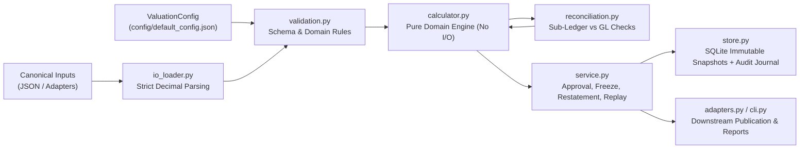
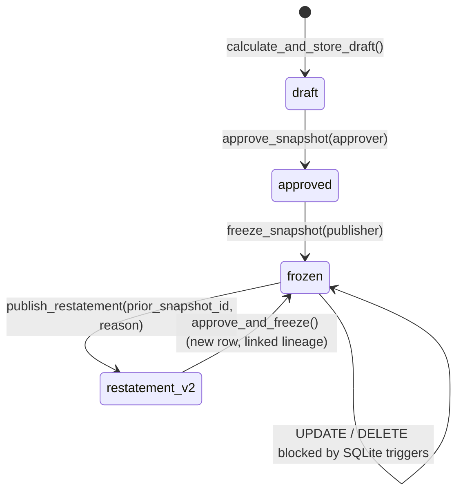

# Architecture & ADR-001

## 1. Component Architecture

The engine enforces strict architectural separation between source-record ingestion, pure deterministic calculation, ledger reconciliation, immutable persistence, and operator/downstream interfaces.

## 2. Valuation & Restatement Lifecycle

## 3. Core Invariants

1. **Accounting Identity:** For every calculated snapshot, `net_assets == gross_assets - total_liabilities` at base currency minor-unit precision (`Decimal`, configured rounding mode).
2. **Share-Class Conservation:** When opening shares are positive, the sum of class-level closing net assets in base currency equals fund-level `net_assets` exactly; rounding residuals from pro-rata splits are deterministically assigned using largest-remainder then largest-weight then lexicographic `share_class_id` tie-breaking.
3. **Zero-Share Safety:** Share classes with zero closing shares never trigger division-by-zero; they emit `zero_shares_flag = true` and `nav_per_share = null`. Exact full redemptions pay out exact remaining class net assets leaving `0.00` balance.
4. **Determinism & Order Invariance:** `ValuationInputBundle.to_dict()` canonically sorts all record collections by primary identifier and serializes `Decimal` values as fixed-point strings. Shuffling input record order produces identical `input_hash`, `snapshot_id`, and `output_hash`.
5. **Physical Immutability:** Once a snapshot transitions to `frozen`, SQLite `BEFORE UPDATE` and `BEFORE DELETE` triggers raise `ABORT` (`FROZEN_SNAPSHOT_IMMUTABLE`), translated by the store into `ImmutabilityViolationError` (`NAV-5001`). The `audit_journal` table is similarly append-only.
6. **Auditable Lineage:** Every restatement requires a `frozen` prior snapshot and a non-empty `restatement_reason`, increments `version = prior.version + 1`, stores a foreign-key `prior_snapshot_id` reference, and logs a structured `RESTATEMENT_DIFF_RECORDED` entry in `audit_journal`.

## 4. Key Trade-Offs

| Decision | Trade-Off | Rationale |
|---|---|---|
| Pure Python stdlib (`Decimal`, `sqlite3`) | Lower raw throughput than C/Rust extensions; single-writer concurrency vs PostgreSQL | Zero external runtime dependencies, deterministic exact arithmetic, clean offline reproducibility in any Python 3.9+ environment |
| Forward-priced T+0 flow accounting (`+Subscriptions` in Gross Assets, `+Redemptions` in Liabilities) | Closing NAV includes dealing receivables/payables alongside pre-flow valuation | Preserves exact `NAV == Gross Assets - Liabilities` identity across dealing cycles while exposing both pre-flow and closing balances |
| Separate immutable rows per restatement (never mutating `frozen` rows) | Queries for "latest published NAV" must select max `version` with `status = 'frozen'` | Guarantees historical published snapshots remain byte-identical and verifiable forever |

---

## ADR-001: Exact Decimal Arithmetic & Trigger-Enforced SQLite Immutability

- **Status:** Accepted
- **Date:** 2026-03-31 (prototype baseline)
- **Context:** Fund NAV accounting cannot tolerate IEEE-754 binary floating-point rounding drift or silent post-publication overwrites of official NAV records. Additionally, this educational prototype must run reproducibly offline with minimal setup friction.
- **Decision:**
  1. All monetary amounts, prices, FX rates, and share counts are parsed strictly into Python `decimal.Decimal` via `parse_decimal()`, explicitly rejecting Python `float` and `bool` inputs.
  2. All monetary quantization uses explicit ISO-4217 currency precision maps and `ROUND_HALF_EVEN` (configurable in `ValuationConfig`).
  3. Snapshot persistence uses Python's built-in `sqlite3` with foreign keys enabled and database-level `BEFORE UPDATE` / `BEFORE DELETE` triggers preventing any modification of `frozen` snapshots or `audit_journal` rows.
  4. Every snapshot stores SHA-256 hashes of canonical input (`input_hash`) and deterministic output (`output_hash`) to support offline replay verification.
- **Consequences:**
  - Positive: Eliminates floating-point drift; enforces immutability even against accidental SQL updates; zero third-party installation failures.
  - Negative / Future Work: Production multi-node deployments would require migrating the `SqliteNavStore` repository interface to PostgreSQL with equivalent triggers, row-level access controls, and external key-managed signing.
