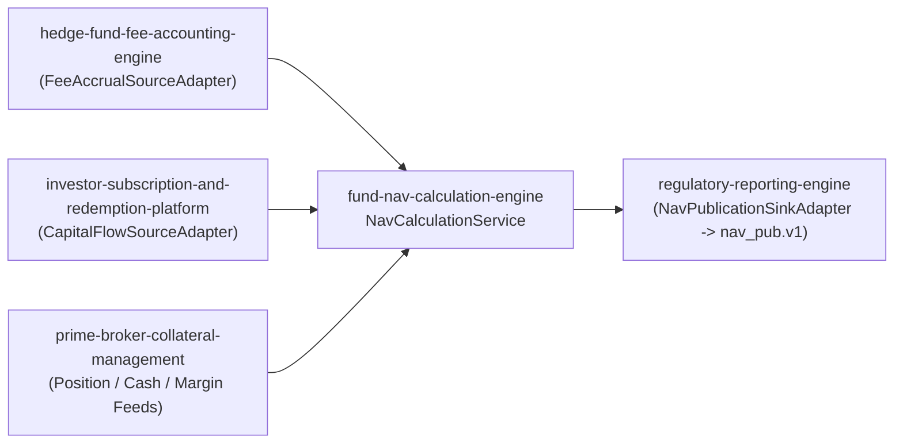

# Integration Boundaries (`Trading-Management`)

## 1. Repository Context

The `Trading-Management` repository contains seven independent sibling projects at the repository root:

- `fund-nav-calculation-engine/` (this project)
- `integrated-hedge-fund-management-platform/`
- `hedge-fund-fee-accounting-engine/`
- `investor-subscription-and-redemption-platform/`
- `prime-broker-collateral-management/`
- `fund-performance-and-investor-reporting-dashboard/`
- `regulatory-reporting-engine/`

To keep each project independently runnable without cross-package code coupling, this engine defines **independent runnable adapter contracts** in `src/fund_nav_engine/adapters.py` that exchange versioned JSON/dict payloads rather than directly importing sibling packages.

## 2. Adapter Boundaries

### Upstream Adapters (`src/fund_nav_engine/adapters.py`)

1. **`FeeAccrualSourceAdapter` / `DictFeeAccrualAdapter`:**
   - Translates external management/performance fee accrual records into canonical `AccrualRecord` (`direction = liability`) scoped to either fund-level or `share_class_id`.
2. **`CapitalFlowSourceAdapter` / `DictCapitalFlowAdapter`:**
   - Translates investor subscription/redemption order payloads into canonical `CapitalFlowRecord` objects with explicit UTC `submitted_at`, `trade_date`, `settlement_date`, and `timing_rule`.
3. **Position & Collateral Balances:**
   - Prime broker positions, cash balances, and margin payables enter through canonical `PositionRecord`, `LiabilityRecord`, and `LedgerBalanceRecord` JSON/dict contracts (`bundle_from_dict`).

### Downstream Publication (`RegulatoryReportingNavPublisher`)

- Implements `NavPublicationSinkAdapter` and transforms a `frozen` `NavCalculationResult` into a stable `nav_pub.v1` JSON summary containing `snapshot_id`, `version`, `prior_snapshot_id`, `output_hash`, fund totals, and per-class NAV per share.

## 3. Compatibility & Non-Production Boundaries

- **Dependencies:** Zero runtime external packages; Python >= 3.9 stdlib only.
- **No Proprietary Dependencies:** Contains zero imports, schemas, credentials, or data from any private employer or SAAT codebase.
- **Out-of-Scope Production Integrations:** Live market data feeds (Bloomberg/Refinitiv), live custodian/prime-broker SFTP/FIX feeds, transfer-agency order routers, and PostgreSQL production clusters are intentionally excluded from this prototype.
