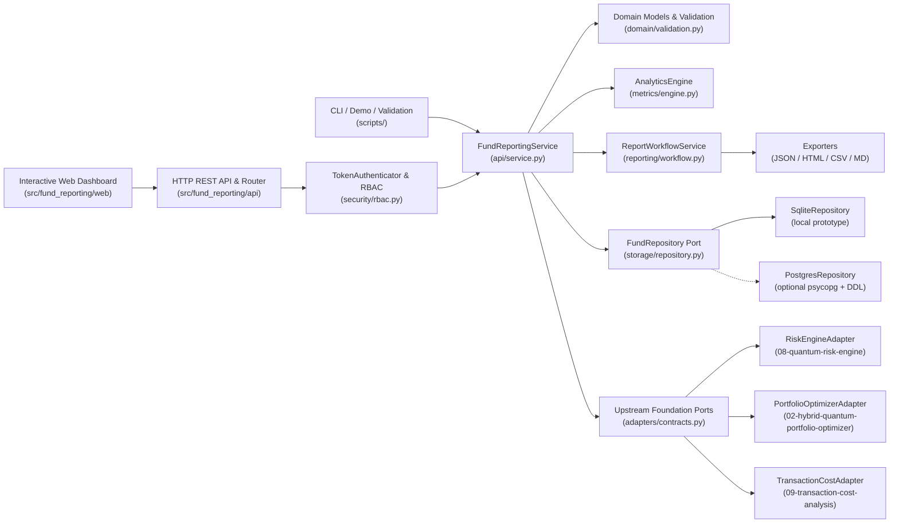

# Architecture & Component Boundaries

## System Overview

The system is organized into five strict, single-process layers with explicit domain contracts, fail-closed validation, and isolated external adapters.

## Component Responsibilities

| Component | Package | Responsibility & Boundary |
|---|---|---|
| **Domain & Validation** | `src/fund_reporting/domain/` | Canonical immutable dataclasses (`FundDefinition`, `NavSnapshot`, `CashFlowRecord`, `FxRateRecord`, `BenchmarkPoint`, `StrategySnapshot`, `ReportRecord`, `AuditEvent`), structured `DomainError` hierarchy, UTC timestamp validation, NAV bridge reconciliation, and environment homogeneity enforcement. |
| **Return & Risk Library** | `src/fund_reporting/metrics/` | Stateless, deterministic computations for daily TWR, Modified Dietz, drawdown, annualized volatility, Sharpe/Sortino/Calmar, historical VaR/CVaR, benchmark comparison, point-in-time FX conversion, and Carino-linked strategy attribution. |
| **Persistence** | `src/fund_reporting/storage/` | `FundRepository` abstract contract isolating business logic from database drivers. Ships with `SqliteRepository` for zero-setup reproducibility and `PostgresRepository` + `config/schema_postgres.sql` for approved sandbox/production PostgreSQL deployments. |
| **Upstream Adapters** | `src/fund_reporting/adapters/` | Clean port interfaces for `08-quantum-risk-engine`, `02-hybrid-quantum-portfolio-optimizer`, and `09-transaction-cost-analysis`. Local deterministic adapters provide synthetic diagnostics without copying external personal code whose licensing/IP ownership is pending confirmation. |
| **Security & Governance** | `src/fund_reporting/security/` | Bearer-token authentication, RBAC permission matrix, fund-level investor entitlements, dual-control separation of duties, and append-only `audit_log` persistence. |
| **Versioned Reporting** | `src/fund_reporting/reporting/` | Lifecycle state machine (`DRAFT -> SUBMITTED -> REVIEWED -> PUBLISHED -> SUPERSEDED`), content-addressed immutable `version_id` and SHA-256 digests, revision chaining, and JSON/HTML/CSV/Markdown exporters. |
| **API & Dashboard UI** | `src/fund_reporting/api/`, `src/fund_reporting/web/` | Decoupled `ApiRouter` + `ThreadingHTTPServer` serving both `/api/v1/*` and the zero-CDN interactive web UI. |

## Failure Modes & Fail-Closed Guarantees

- **Missing NAV / Date Gap** -> Raises `MissingNavError` (`422 MISSING_NAV`); never silently forward-fills unapproved valuations.
- **Ledger Bridge Mismatch** -> Raises `ReconciliationError` (`422 LEDGER_RECONCILIATION_FAILED`) on ingestion or roll-forward break.
- **Mixed Environments** -> Raises `MixedEnvironmentError` (`422 MIXED_ENVIRONMENT_PROHIBITED`) whenever `SIMULATED`, `PAPER`, and `LIVE` records are combined.
- **Missing Point-in-Time FX** -> Raises `CurrencyConversionError` (`422 MISSING_FX_RATE`).
- **Zero Volatility / Inadequate History** -> Returns `None` for undefined ratios (`sharpe_ratio`, `sortino_ratio`, `calmar_ratio`, `information_ratio`) and attaches explicit `MetricFlag` entries; never emits `NaN` or `Infinity`.
- **Immutable Published Reports** -> Any attempt to edit a `PUBLISHED` or `SUPERSEDED` report raises `ImmutableReportError` (`409`); corrections require creating a linked revision.
- **Unauthorized Access / Self-Approval** -> Returns `401` or `403` (`UNAUTHORIZED_ACCESS` / `SEPARATION_OF_DUTIES_VIOLATION`) and logs a `DENY` entry in `audit_log`.
