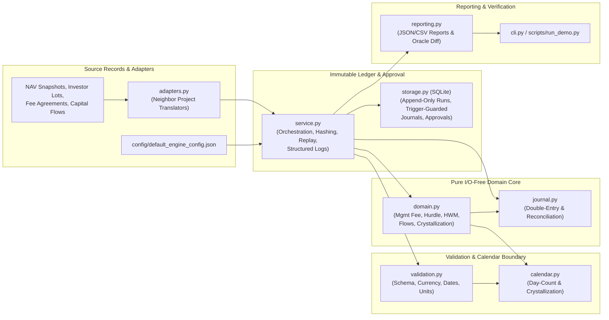

# Architecture — Hedge Fund Fee Accounting Engine

## 1. System Overview and Layer Boundaries

The Hedge Fund Fee Accounting Engine enforces strict separation between input validation, pure domain fee calculations, double-entry journaling, immutable SQLite persistence, approval state transitions, and external reporting/adapters.

## 2. Data Flow

1. **Configuration Load**: `EngineConfig.from_json_file` loads pinned rounding rules, intermediate precision (`28` digits), currency minor-unit scales, and chart of accounts.
2. **Input Validation**: `validation.py` parses exact `Decimal` strings (rejecting IEEE-754 floats), validates share-class/currency alignment, enforces positive units and non-negative NAVs, checks crystallization boundary integrity, and guards against excessive redemptions.
3. **Pure Domain Evaluation**: `domain.py` processes mid-period capital flows in chronological `(flow_date, flow_id)` order:
   - **Subscriptions** create new series/lots with distinct subscription dates, pro-rata accrual periods, and individual high-water marks.
   - **Redemptions** split off redeemed units, crystallize accrued management and performance fees on the redemption date, and proportionally adjust remaining units and dollar loss carryforward while preserving per-unit HWM.
   - **Period-end valuation** computes management fee accrual, hurdle benchmark, effective benchmark `max(HWM, hurdle)`, performance fee accrual/reversal delta, crystallization settlement (on scheduled crystallization dates), and updated lot state.
4. **Double-Entry Journaling & Reconciliation**: `journal.py` produces balanced debit/credit entries and enforces 8 accounting invariants via `reconcile_run` before persistence.
5. **Immutable Persistence & Versioning**: `storage.py` persists agreements, inputs, run outputs, and journal entries in SQLite with `BEFORE UPDATE` and `BEFORE DELETE` triggers on `journal_entries` and `journal_lines`. Corrections never overwrite prior runs: `apply_correction` creates version `v+1`, emits reversing entries linked via `supersedes_entry_id`, posts corrected entries, and marks the prior run `SUPERSEDED`.
6. **Deterministic Replay**: `replay_run` loads stored versioned inputs from SQLite, re-executes the pure calculation pipeline, and verifies bit-for-bit equality of `output_hash`.

## 3. Core Invariants

- **Exact Arithmetic**: No binary `float` values enter financial calculations; all intermediate arithmetic runs in a local `Decimal` context (`prec=28`) and final monetary amounts quantize to currency minor units using `ROUND_HALF_EVEN` (or configured mode).
- **Double-Entry Balance**: Every `JournalEntry` satisfies `sum(debits) == sum(credits)` with non-negative line amounts.
- **No Negative or Duplicate Accrual**: Management fee accruals and cumulative performance fee accruals are strictly `>= 0`. Duplicate runs for `(agreement_id, valuation_date, version)` are blocked by both service checks and SQLite `UNIQUE` constraints.
- **NAV Bridge Reconciliation**: Across all evaluated lots in a run, `sum(gross_ending_nav) - sum(management_fee) - sum(target_cumulative_perf_fee) == sum(ending_net_nav)`.
- **Immutability**: Posted journal rows cannot be mutated or deleted in SQLite; corrections are append-only versioned events.
- **HWM Non-Reduction**: High-water marks never reset downward on drawdowns and never reset on interim non-crystallization valuation dates.

## 4. Key Trade-Offs

- **Series / Lot Accounting vs. Equalization Credits**: This prototype models per-investor lots/series with individual HWMs and subscription dates rather than equalization credit/depreciation deposit accounts. Lot/series accounting is deterministic, auditable, and matches a wide share of offshore hedge fund structures; equalization credits are explicitly marked out of scope.
- **Standard-Library Stack (`Decimal` + `sqlite3`)**: Zero third-party runtime dependencies ensure offline reproducibility, clean licensing (PSF stdlib), and instant portability across Python 3.9+ environments, at the trade-off of single-node SQLite concurrency (suitable for research/prototype workloads, not multi-writer production).
- **Post-Fee NAV Per Unit Quantization**: Intermediate `post_mgmt_nav_per_unit` uses full intermediate precision when calculating performance fees and quantizes displayed per-unit NAVs to 6 decimals, avoiding cumulative double-rounding artifacts.
