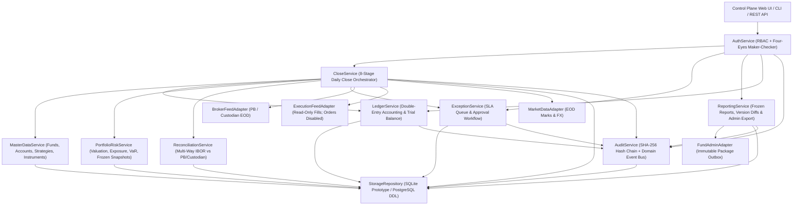

# System Architecture & Component Boundaries

## 1. High-Level Architecture

The platform is structured as a single-process modular control plane with explicit domain contracts, strict separation between external provider adapters and core accounting/risk logic, and a PostgreSQL-compatible relational persistence boundary (`SQLiteStore` for local reproducible execution, `docs/schema.sql` for PostgreSQL migration).

## 2. Component Boundaries & Data Ownership

| Component | Module(s) | Canonical Responsibility | Owned State | Explicit Boundary / Invariant |
|---|---|---|---|---|
| **Fund / Account / Strategy Master** | `domain/master.py`, `services/master_service.py` | Validate and publish canonical entity definitions and user principals. | `funds`, `accounts`, `strategies`, `instruments`, `counterparties`, `users` | Rejects dangling foreign keys; versioned bundles; UTC timestamps. |
| **Double-Entry Ledger** | `domain/ledger.py`, `services/ledger_service.py` | Maintain fund accounting entries (opening capital, fills, EOD MTM, fee accruals, manual adjustments) and trial balance. | `journal_entries` | Hard invariant: `sum(debits) == sum(credits)` per currency on every entry; exact `Decimal` arithmetic. |
| **Consolidated Portfolio & Risk** | `domain/portfolio.py`, `services/portfolio_risk_service.py` | Compute weighted-average cost lots, multi-currency NAV, risk/exposure metrics, strategy attribution, and immutable snapshots. | `portfolio_snapshots`, `manual_marks` | Rejects missing/stale marks; reconciles NAV against ledger to `$0.00`; frozen snapshots are immutable & SHA-256 hashed. |
| **Daily Close & Reconciliation** | `domain/reconciliation.py`, `services/reconciliation_service.py`, `services/close_service.py` | Execute ordered 8-step EOD close checklist and match IBOR positions/cash/fills against prime broker extracts. | `fills`, `reconciliations`, `close_runs` | Quarantines fills after 21:00 UTC cutoff; blocks close on unresolved breaks or missing marks; halts safely (`DEGRADED_OUTAGE`) on provider outages. |
| **Exception Management & Approvals** | `domain/workflow.py`, `services/exception_service.py`, `services/auth_service.py` | Track operational breaks/incidents with SLAs and enforce RBAC + four-eyes maker-checker separation. | `exceptions` | Maker cannot approve own proposal/close/report; unauthorized roles denied & logged. |
| **Reporting & Audit History** | `domain/reporting.py`, `domain/audit.py`, `services/reporting_service.py`, `services/audit_service.py` | Generate versioned reports from frozen snapshots, track revision diffs, deliver admin packages, and maintain hash-chained audit trail & event stream. | `reports`, `audit_log`, `domain_events` | Rejects unfrozen snapshots; revisions require mandatory reason & dual-control approval; audit log is append-only & tamper-evident. |
| **External Provider Adapters** | `adapters/interfaces.py`, `adapters/fixture_adapters.py` | Isolate external broker, OMS, market data, fund admin, and event bus contracts from business logic. | None (stateless interfaces) | Supports deterministic fixtures & fault injection; order execution is disabled by policy (`order_execution_enabled=false`). |

## 3. Core Design Assumptions

1. **Deterministic Monetary Math**: All quantities, prices, FX rates, fees, and NAV values use `decimal.Decimal` with explicit `ROUND_HALF_UP` cent quantization (`0.01`).
2. **UTC Time Semantics**: Every event timestamp (`executed_at_utc`, `as_of_utc`) and availability timestamp (`received_at_utc`, `available_at_utc`) is normalized to timezone-aware UTC.
3. **Single-Process Modularity First**: Following `plan.md` Section 3, domain boundaries are enforced via Python interfaces and transactional SQLite storage before introducing distributed queues or microservices.
4. **Execution Safety**: Automated order routing is explicitly blocked by `ExecutionControlsConfig.order_execution_enabled = false` (`POL-EXEC-001-DISABLED-BY-DEFAULT`).
