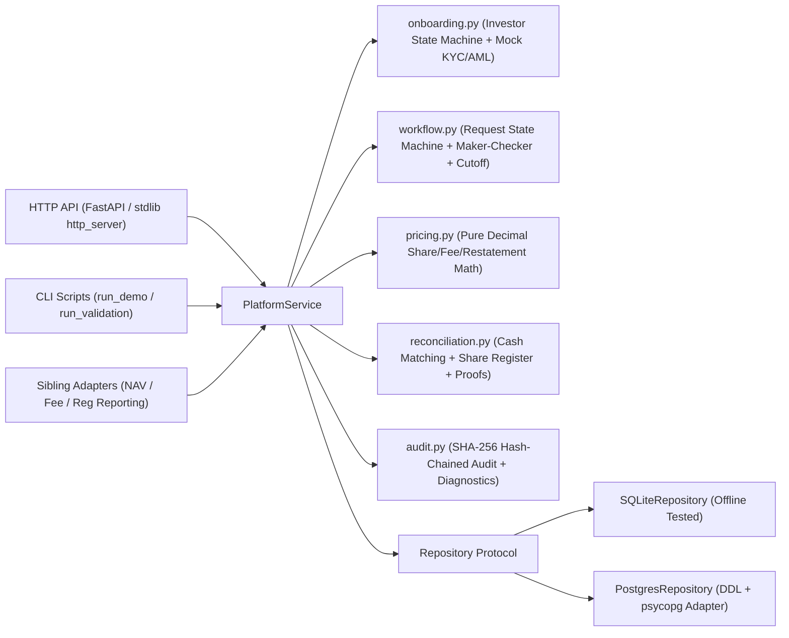
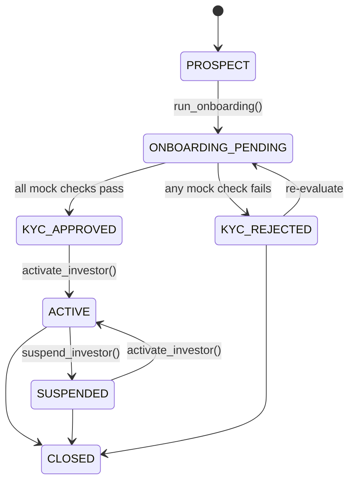
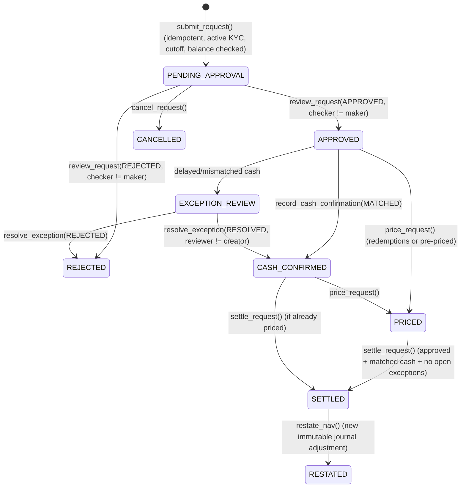

# Architecture — Investor Subscription and Redemption Platform

## 1. Component Architecture

The platform separates source records, pure `Decimal` pricing calculations, workflow state machines, immutable share journals, hash-chained audit logs, persistence adapters, and HTTP transport.

## 2. State Machines

### Investor Onboarding Lifecycle

### Capital Flow Request Lifecycle

## 3. Core Invariants

1. **Exact Decimal Arithmetic:** All cash, fee, NAV, and share values use `decimal.Decimal` with explicit quantization (`2dp` cash, `6dp` shares/NAV, `ROUND_HALF_UP`). Floating-point inputs are rejected at the contract boundary.
2. **Unapproved Requests Cannot Settle:** `price_request()` and `settle_request()` both invoke `ensure_request_approved()`, enforcing presence of `checker_id != maker_id` and `approved_at`.
3. **Maker-Checker Separation:** Enforced across request review, exception resolution, and NAV restatement.
4. **Immutable Append-Only Ledger & Corrections as New Versions:** `share_journal` rows and `audit_events` are append-only. Settled requests cannot be mutated or cancelled; NAV restatements create a new `NAVRecord` version, mark the prior version `SUPERSEDED`, and append a `NAV_RESTATEMENT_ADJUSTMENT` entry referencing `supersedes_entry_id`.
5. **Exact Share & Cash Reconciliation:** `verify_platform_reconciliation()` asserts zero discrepancy between the aggregated share register, the sum of immutable journal deltas, and confirmed inbound/outbound cash for settled requests, and verifies no negative share balances exist.
6. **Tamper-Evident Audit Chain:** Every state transition and blocked failure appends an `AuditEvent` linked via `SHA-256(sequence, event_id, timestamp, actor_id, action, entity_type, entity_id, payload, prev_hash)`.

## 4. Key Trade-offs

- **Offline Core vs. Optional Web/DB Stack:** Core domain, SQLite repository, and stdlib HTTP router have zero third-party runtime dependencies so every test and demo runs deterministically in air-gapped Python 3.9+ environments. FastAPI and PostgreSQL adapters are included with pinned optional dependencies (`pyproject.toml`, `requirements.txt`, `001_initial_schema.sql`).
- **Rounding Residual Accounting:** Subscription share issuance (`net_cash / nav_per_share`) can produce sub-cent rounding residuals when `net_cash` is not evenly divisible by NAV. Rather than hiding dust, `PricingCalculation` records `rounding_residual` explicitly and rejects residuals exceeding `rounding.max_valuation_residual` (`0.01` default).
- **Single-Writer Sequential Audit Chain:** The hash-chained audit sequence is linear and deterministic, which simplifies verification and replay in an educational prototype; high-concurrency production deployments would require serialized sequence allocation or database advisory locking in PostgreSQL.
