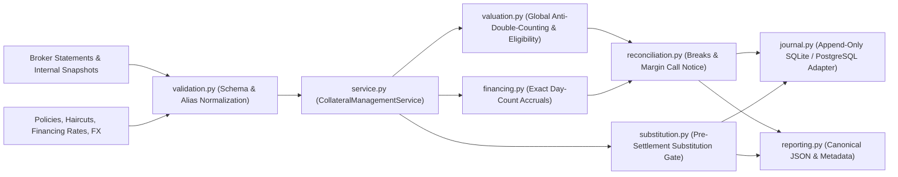

# Architecture — Prime Broker Collateral Management

## 1. System Overview & Boundaries

The Prime Broker Collateral Management engine separates **source normalization**, **pure domain calculations**, **append-only versioned persistence**, **approval/gating**, and **reporting** into explicit modules so domain calculations remain deterministic, testable without I/O, and auditable.

## 2. Module Responsibilities

| Module | Layer | I/O | Responsibility |
|---|---|---|---|
| `models.py` | Domain Types | None | Frozen dataclasses, ISO currency minor units, rounding map, domain enums |
| `errors.py` | Domain Errors | None | Typed domain exceptions with stable error codes and structured context |
| `validation.py` | Ingestion / Boundary | None | Strict `Decimal` parsing (rejects IEEE-754 floats), alias normalization, canonical SHA-256 hashing |
| `fx.py` | Domain Calculation | None | Direct, inverse, and USD-triangulated exact FX lookup and conversion |
| `valuation.py` | Domain Calculation | None | Policy rule matching, base + FX-mismatch haircuts, concentration caps, encumbrance buckets, failed-transfer quarantine, and global no-double-counting checks |
| `financing.py` | Domain Calculation | None | Daily/multi-day debit, credit, and short-rebate accruals across `ACT_360`, `ACT_365F`, `ACT_ACT_ISDA`, and `THIRTY_360` |
| `reconciliation.py` | Domain Calculation | None | Position, cash, collateral-valuation, financing-accrual, and failed-transfer break detection plus MTA/rounding-increment margin call notices |
| `substitution.py` | Domain / Gating | None | Simulates releasing pledged lots and pledging replacement lots; blocks settlement before execution if a shortfall or double-count would occur |
| `journal.py` | Persistence | SQLite / PG | Append-only versioned journal blocking `UPDATE`/`DELETE` via DB triggers; idempotent duplicate detection and deterministic replay |
| `service.py` | Orchestration | Logging / Store | Coordinates multi-broker batches, structured JSON event logs, diagnostic counters, and replay |
| `reporting.py` & `cli.py` | Presentation | File / Stdout | Canonical sorted-key JSON serialization with runtime metadata and config hashes |

## 3. Core Invariants

1. **No Collateral Double-Counting:**
   - Within a single broker statement, duplicate `lot_id` entries are rejected during validation.
   - Across brokers in a portfolio batch, `verify_no_global_double_counting` rejects any `lot_id` simultaneously marked active (`UNENCUMBERED`, `PLEDGED_MARGIN`, `REHYPOTHECATED`, `LOCKED_SUBSTITUTION`) at more than one broker.
   - Inbound transfers marked `FAILED` or `PENDING_TRANSFER_IN` are never counted as posted margin; outbound `PENDING_TRANSFER_OUT` lots are excluded from available collateral while in flight.
2. **Exact Monetary Arithmetic:**
   - All quantities, prices, FX rates, haircuts, and accruals use Python `decimal.Decimal`. Raw JSON floats are rejected during parsing.
   - Currency quantization uses explicit minor-unit tables (`USD/EUR/GBP/CHF = 2`, `JPY = 0`) and configurable rounding (`ROUND_HALF_EVEN` default; `ROUND_CEILING` for margin call increments; `ROUND_FLOOR` for excess recall increments).
3. **Immutable Versioned History:**
   - Corrections cannot overwrite prior statement or reconciliation records. SQLite and PostgreSQL triggers abort `UPDATE` and `DELETE` operations; corrections must be submitted with an incremented `version` and `supersedes_statement_id`.
4. **Pre-Settlement Shortfall Gating:**
   - Margin calls flag shortfalls before settlement (`flagged_before_settlement = True`).
   - Collateral substitutions simulate the post-substitution portfolio (including secondary concentration-limit impacts) and set `settlement_permitted = False` with `AUTO_FLAGGED_SHORTFALL` whenever projected posted collateral falls below margin requirement, leaving original positions unchanged.

## 4. Key Trade-offs

- **Zero-dependency core vs. ORM/Pydantic:** Using Python 3.9+ stdlib (`dataclasses`, `decimal`, `sqlite3`, `json`, `hashlib`) guarantees deterministic offline execution with zero transitive license or build risk, while explicit validation functions enforce strict schemas.
- **SQLite default journal + PostgreSQL DDL/adapter:** Provides an immediate, self-contained, trigger-enforced immutable relational ledger locally, while shipping production-shaped PostgreSQL DDL (`postgres_schema.sql`) and `PostgresJournalAdapter` for PostgreSQL 14+ deployments.
- **Deterministic single-pass concentration trim:** Asset-class concentration limits are evaluated against pre-cap posted eligible collateral and allocated proportionally in sorted `lot_id` order (remainder to final lot). More complex iterative LP collateral optimization is intentionally out of scope for this educational prototype.
