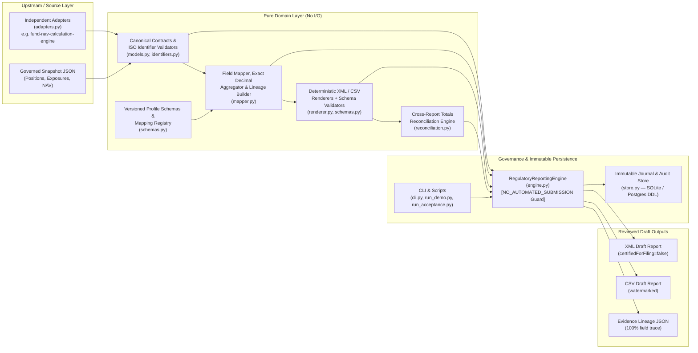

# Architecture — Regulatory Reporting Engine

## 1. Component Architecture

## 2. Layer Boundaries

1. **Source Records (`models.py`, `identifiers.py`, `adapters.py`)**
   - Parses raw dictionaries into frozen dataclasses (`GovernedSnapshot`, `FundMetadata`, `ReportingPeriod`, `NavRecord`, `PositionRecord`, `ExposureRecord`).
   - Enforces exact `Decimal` parsing (explicitly rejecting IEEE-754 `float`), NAV accounting identity (`GAV - Liabilities == NAV`), position FX consistency (`quantity * price_local * fx_rate_to_base == market_value_base`), exposure gross/net identities, and ISO 17442 LEI / ISO 6166 ISIN check digits.
   - Computes canonical `payload_sha256` over sorted JSON for content-addressed deduplication and replay verification.

2. **Schema & Mapping Governance (`schemas.py`, `mapper.py`)**
   - Pure domain functions with zero database or network I/O.
   - Loads dated jurisdiction/profile schemas (`config/profiles/*.json`) and versioned mapping specifications (`config/mappings/*.json`).
   - Detects schema evolution drift (`validate_mapping_against_schema`) and compares schema versions (`compare_schema_versions`).
   - Emits both `fields` (exact `Decimal` / `int` / `str`) and `lineage` (`FieldLineage` per output field) with a runtime completeness invariant verifying 100% coverage.

3. **Deterministic Rendering & Validation (`renderer.py`, `schemas.py`)**
   - Serializes fields in canonical schema declaration order into XML and CSV with mandatory non-certified watermarks (`certifiedForFiling="false"`).
   - Immediately round-trip validates rendered XML and CSV strings back against the `ProfileSchema` before returning a `ReportArtifact`.

4. **Cross-Report Reconciliation (`reconciliation.py`)**
   - Compares corresponding totals across distinct jurisdiction reports (e.g., US Form PF-style vs. EU AIFMD-style) and checks internal schedule additivity (e.g., sum of asset-class exposure buckets equals gross AUM).
   - Fails loudly with structured `CrossReportReconciliationError` (`REG-3001`) unless `fail_on_mismatch=False` is requested for diagnostic inspection.

5. **Immutable Journal, Corrections & Approval Audit (`store.py`, `engine.py`)**
   - Persists governed snapshots, report versions, and approval transitions to an append-only store (`SqliteJournalStore`, mirroring `sql/schema_postgres.sql`).
   - Enforces database-level `BEFORE UPDATE` / `BEFORE DELETE` immutability triggers on snapshots, audit rows, and report payloads.
   - Enforces single-filing uniqueness (`filing_key = fund_id::period_id::profile_id`): duplicate v1 attempts raise `DuplicateFilingError` (`REG-4001`); changes must be recorded as a new immutable version via `create_correction()`, automatically superseding the prior version.
   - Cryptographically hash-chains every report's approval audit log (`prev_event_sha256 -> event_sha256`) so tampering is detectable via `verify_audit_chain()`.
   - Structurally blocks automated submission via both `load_config()` and `engine.submit_to_regulator()` (`AutomatedSubmissionProhibitedError`, `REG-9001`).

## 3. Core Invariants

| Invariant | Enforcement Mechanism |
|---|---|
| Exact decimal accounting | Floats rejected (`REG-1004`); explicit rounding mode & decimal scale per rule |
| 100% output field lineage | Runtime assertion in `map_snapshot_to_profile()` verifies `set(fields) == set(lineage)` |
| Schema-validated XML & CSV | Round-trip `validate_xml_against_schema()` & `validate_csv_against_schema()` on every render |
| Immutable history | SQLite/PostgreSQL triggers block mutation/deletion of snapshots, report content, and audit logs |
| No silent overwrites | Unique `(filing_key, version_number)` + explicit `DuplicateFilingError` on re-filing |
| No automated filing | `automated_submission_enabled` must be `false`; `submit_to_regulator()` always raises `REG-9001` |
| Deterministic replay | Stable `report_id` derived from `(filing_key, version_number, content_sha256[:12])` |

## 4. Key Trade-Offs

- **Zero-dependency standard library core vs. Pydantic/lxml/PostgreSQL runtime:** Choosing Python stdlib dataclasses, `xml.etree.ElementTree`, and `sqlite3` guarantees clean offline reproducibility on any Python 3.9+ environment while keeping optional Pydantic/PostgreSQL/lxml adapters cleanly isolated behind protocol boundaries (see [ADR-0001](adr/0001-architecture-and-stack-decisions.md)).
- **Declarative JSON schemas/mappings vs. hardcoded Python report builders:** Declarative rules enable deterministic schema-diff analysis, clean v1->v2 evolution, and uniform lineage capture across jurisdictions, at the cost of restricting derived expressions to explicitly audited formula primitives (`ratio`, `percent_ratio`) rather than arbitrary `eval()`.
